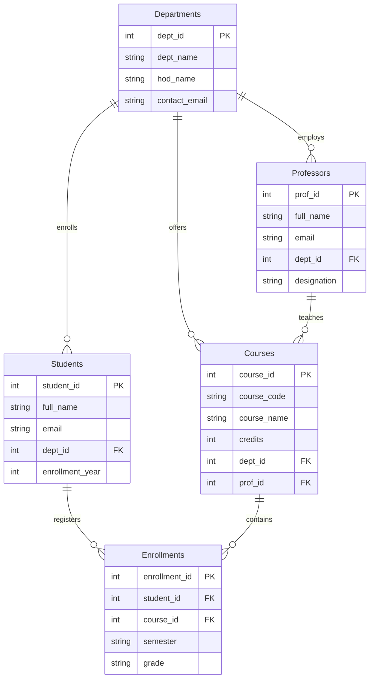

# Database Design and ER Documentation: College Management System

**Institution:** DKTE Society's Textile & Engineering Institute, Ichalkaranji  
**Course:** Generative Artificial Intelligence Lab (01MCP205)  
**Set:** 6 | **Question:** Q.4 (25 Marks)  

---

## 1. Problem Statement (Task a)
College Management System (CMS) Database Design:  
The objective is to design a centralized, relational database system for DKTE Society's Institute to manage academic operations, student enrollments, faculty allocations, and departmental course management. The system eliminates data redundancy, enforces referential integrity, and provides a structured schema for academic record keeping.

---

## 2. Main Entities and Attributes (Task a & b)

### Entity: `Departments`
- **Description:** Stores institutional academic departments.
- **Primary Key:** `dept_id`
- **Foreign Keys:** None
- **Attributes:**
  - `dept_id`: INTEGER PRIMARY KEY AUTOINCREMENT
  - `dept_name`: TEXT NOT NULL UNIQUE
  - `hod_name`: TEXT NOT NULL
  - `contact_email`: TEXT NOT NULL

### Entity: `Students`
- **Description:** Stores registered student personal and academic details.
- **Primary Key:** `student_id`
- **Foreign Keys:** `dept_id` -> `Departments(dept_id)`
- **Attributes:**
  - `student_id`: INTEGER PRIMARY KEY AUTOINCREMENT
  - `full_name`: TEXT NOT NULL
  - `email`: TEXT NOT NULL UNIQUE
  - `dept_id`: INTEGER NOT NULL
  - `enrollment_year`: INTEGER NOT NULL

### Entity: `Professors`
- **Description:** Maintains teaching faculty records and qualifications.
- **Primary Key:** `prof_id`
- **Foreign Keys:** `dept_id` -> `Departments(dept_id)`
- **Attributes:**
  - `prof_id`: INTEGER PRIMARY KEY AUTOINCREMENT
  - `full_name`: TEXT NOT NULL
  - `email`: TEXT NOT NULL UNIQUE
  - `dept_id`: INTEGER NOT NULL
  - `designation`: TEXT NOT NULL

### Entity: `Courses`
- **Description:** Academic subjects offered across programs.
- **Primary Key:** `course_id`
- **Foreign Keys:** `dept_id` -> `Departments(dept_id)`, `prof_id` -> `Professors(prof_id)`
- **Attributes:**
  - `course_id`: INTEGER PRIMARY KEY AUTOINCREMENT
  - `course_code`: TEXT NOT NULL UNIQUE
  - `course_name`: TEXT NOT NULL
  - `credits`: INTEGER NOT NULL
  - `dept_id`: INTEGER NOT NULL
  - `prof_id`: INTEGER NOT NULL

### Entity: `Enrollments`
- **Description:** Associative entity mapping students to courses for grading.
- **Primary Key:** `enrollment_id`
- **Foreign Keys:** `student_id` -> `Students(student_id)`, `course_id` -> `Courses(course_id)`
- **Attributes:**
  - `enrollment_id`: INTEGER PRIMARY KEY AUTOINCREMENT
  - `student_id`: INTEGER NOT NULL
  - `course_id`: INTEGER NOT NULL
  - `semester`: TEXT NOT NULL
  - `grade`: TEXT

---

## 3. Entity Relationships and Cardinality (Task c)
- **Departments -> Students** (`One-to-Many (1:N)`): A department enrolls multiple students; each student belongs to exactly one department.
- **Departments -> Professors** (`One-to-Many (1:N)`): A department employs multiple professors; each professor is affiliated with one department.
- **Professors -> Courses** (`One-to-Many (1:N)`): A professor can teach multiple courses; each course is coordinated by an assigned professor.
- **Students <-> Courses (via Enrollments)** (`Many-to-Many (M:N)`): A student can register for multiple courses, and a course has many enrolled students.

---

## 4. Entity-Relationship (ER) Diagram (Task d)


---

## 5. SQL Table Definitions (Task e)
```sql
-- 1. Departments Table
CREATE TABLE IF NOT EXISTS Departments (
    dept_id INTEGER PRIMARY KEY AUTOINCREMENT,
    dept_name TEXT NOT NULL UNIQUE,
    hod_name TEXT NOT NULL,
    contact_email TEXT NOT NULL
);

-- 2. Students Table
CREATE TABLE IF NOT EXISTS Students (
    student_id INTEGER PRIMARY KEY AUTOINCREMENT,
    full_name TEXT NOT NULL,
    email TEXT NOT NULL UNIQUE,
    dept_id INTEGER NOT NULL,
    enrollment_year INTEGER NOT NULL,
    FOREIGN KEY (dept_id) REFERENCES Departments(dept_id) ON DELETE CASCADE
);

-- 3. Professors Table
CREATE TABLE IF NOT EXISTS Professors (
    prof_id INTEGER PRIMARY KEY AUTOINCREMENT,
    full_name TEXT NOT NULL,
    email TEXT NOT NULL UNIQUE,
    dept_id INTEGER NOT NULL,
    designation TEXT NOT NULL,
    FOREIGN KEY (dept_id) REFERENCES Departments(dept_id) ON DELETE CASCADE
);

-- 4. Courses Table
CREATE TABLE IF NOT EXISTS Courses (
    course_id INTEGER PRIMARY KEY AUTOINCREMENT,
    course_code TEXT NOT NULL UNIQUE,
    course_name TEXT NOT NULL,
    credits INTEGER NOT NULL,
    dept_id INTEGER NOT NULL,
    prof_id INTEGER NOT NULL,
    FOREIGN KEY (dept_id) REFERENCES Departments(dept_id) ON DELETE CASCADE,
    FOREIGN KEY (prof_id) REFERENCES Professors(prof_id) ON DELETE CASCADE
);

-- 5. Enrollments Table (Bridge table for M:N)
CREATE TABLE IF NOT EXISTS Enrollments (
    enrollment_id INTEGER PRIMARY KEY AUTOINCREMENT,
    student_id INTEGER NOT NULL,
    course_id INTEGER NOT NULL,
    semester TEXT NOT NULL,
    grade TEXT,
    FOREIGN KEY (student_id) REFERENCES Students(student_id) ON DELETE CASCADE,
    FOREIGN KEY (course_id) REFERENCES Courses(course_id) ON DELETE CASCADE
);
```
